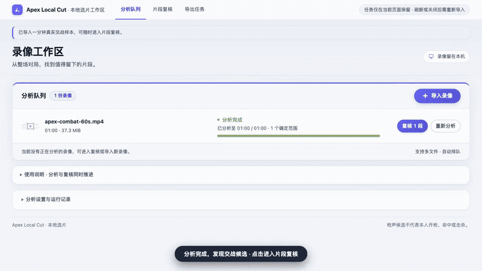

# Apex Local Cut

English | [简体中文](README_zh.md)

**Stop digging through hours of footage manually: Automatically detect gunshot candidates from long Apex Legends recordings, freely trim clips while previewing the source video, and export final cuts directly.**


> 💡 **Note**: The automated detector identifies **gunshot candidate segments pending review** (including fire from the player, teammates, or nearby firefights). It does not guarantee confirmed player kills or highlights. You decide which moments are worth keeping!

---

## 📺 Quick Video Walkthrough

> *Core workflow demo: from importing video and interactive review to clip export.*

[](docs/assets/demo-walkthrough.mp4)

> 💡 **Tip**: Click the animated preview above to watch the [Full HD MP4 Walkthrough](docs/assets/demo-walkthrough.mp4) (33s, 720p 60fps). For the full video storyboard and recording guidelines, see [docs/video-script.md](docs/video-script.md).

---

## 🚀 Try It Online

**No dev environment or desktop installation required—experience it right in modern browsers:**

👉 **[Open Apex Local Cut Online Demo](https://140.143.223.69:8443/)**

- **Browser Requirements**: **Desktop Google Chrome** or **Microsoft Edge** is strongly recommended.
- **Privacy & Security**: Web assets and models load once from the network; **all video decoding, AI audio inference, and clip exports run 100% locally on your machine. Your recordings are never uploaded to any server.**
- **Quick Test**: Once the page loads, click "Try 1-Min Real Combat" to test immediately, or click "Import Video" to pick your local Apex recording.

---

## ✨ Why Use It?

- ⚡ **Review while analyzing—no waiting required**  
  Don't wait for hours-long videos to finish scanning. Analysis runs in the background right after import, with gunshot candidates appearing in real time. Jump straight into detected segments to watch footage, or seek freely to unanalyzed regions anytime.
- 🎯 **Dual interactive timelines: trim clips with source context**  
  - **Upper Source Timeline**: Displays sampled video thumbnail previews, playhead, and trim handles, supporting drag adjustments and 0.1s keyboard precision trimming.
  - **Lower Audio Prediction Timeline**: Shows full audio waveforms and gunshot density, making combat hotspots instantly visible.
  - **One-Key Audition**: Press `Shift + Space` to audition only the active clip selection—playback pauses automatically at the end point before you commit to export.
- 🔒 **100% In-Browser Execution, Zero Bandwidth & Zero Leakage**  
  Powered by modern browser WebCodecs and local WebAssembly AI inference. There is no need to upload multi-gigabyte raw footage to the cloud, protecting your privacy and saving bandwidth.
- 📁 **Direct Save to Your Local Folder**  
  Exports individual clips directly as **MP4** (H.264 + AAC) or **WebM**. Select your output folder once; rendered clips stream straight onto your hard drive—no tedious individual download clicks.
- 🔄 **Multi-Video Queue & Batch Operations**  
  Queue multiple game recordings for sequential analysis. Supports undo/redo (`Ctrl/Cmd + Z`), candidate exclusion, and adding custom manual time ranges as needed.

---

## 🛠️ 3-Step Editing Workflow

| Step | UI Action | Outcome & Details |
| :--- | :--- | :--- |
| **1. Import Video** | Drag & drop files or click "Import Video" | Supports `.mp4`, `.mkv`, `.mov`, `.webm`, etc. Multiple files are queued automatically. |
| **2. Review & Fine-tune** | Click a candidate card to jump; play footage to inspect context | Drag handles on both ends to adjust start/end times. Click "Exclude" or uncheck clips you don't want. |
| **3. Submit Export** | Choose format (MP4/WebM) and click "Submit Clips for Export" | Choose a local save folder on first export. Clips are sliced and saved automatically while you continue adjusting the next batch. |

---

## ⌨️ Keyboard Shortcuts

Keyboard shortcuts are available anywhere on the review page:

| Shortcut | Description |
| :--- | :--- |
| <kbd>Space</kbd> | Play / Pause current video |
| <kbd>Shift</kbd> + <kbd>Space</kbd> | **Audition Clip** (plays only the selected range and pauses automatically at end) |
| <kbd>[</kbd> / <kbd>]</kbd> | Jump to previous / next candidate clip |
| <kbd>←</kbd> / <kbd>→</kbd> | Nudge trim boundary by 0.1s (hold <kbd>Shift</kbd> for 1.0s) |
| <kbd>Del</kbd> / <kbd>Backspace</kbd> | Exclude the currently selected candidate clip |
| <kbd>Ctrl/Cmd</kbd> + <kbd>Z</kbd> | Undo last action |
| <kbd>Ctrl/Cmd</kbd> + <kbd>Shift</kbd> + <kbd>Z</kbd> | Redo last action |
| <kbd>M</kbd> | Mute / Unmute audio |

---

## ⚠️ Notes & FAQ

### Frequently Asked Questions

- **Q: Will tens of gigabytes of long videos crash browser memory?**  
  No. The app uses streaming chunked demuxing and on-demand decoding without loading the entire large file into RAM, ensuring smooth performance even on modest hardware.
- **Q: Why weren't certain intense firefights marked automatically?**  
  The audio model focuses on specific frequency signatures of gunshots. If firefights happen at extreme distance or are masked by loud music / loud party voice chat, scores may fall below the default threshold. You can expand "Filter & Clipping Rules" to lower the threshold and recalculate, or click "Add Manual Range" to select segments manually.
- **Q: If I refresh the page, will my trimmed clips be lost?**  
  **Yes.** To maximize local security and cleanliness, review state and waveforms live only in current browser memory. **Always submit your export and ensure clips are written to disk before refreshing or closing the tab.**
- **Q: Why does the browser prompt to choose an output folder?**  
  To eliminate having to click "Save Download" dozens of times for each clip, the app utilizes native Chrome File System Access API to stream videos directly into your chosen destination folder.

### Current Limitations

1. **Environment:** Relies on modern WebCodecs, WebAssembly, and File System Access APIs. Currently **only desktop Google Chrome and Microsoft Edge are recommended** (mobile browsers and legacy browsers are not supported).
2. **Export Encoding:** Exported MP4/WebM videos are re-encoded matching original resolution and frame rate; this is not a lossless stream copy.
3. **Audio Tracks:** Automatically analyzes the primary default audio track; exported clips preserve the source default audio.

---

## 💻 Developer & Local Setup

If you want to run the static local server from source or contribute to model and timeline development:

### Quick Local Start

```bash
git clone https://github.com/jackliu1111/apex-fps-mvp.git
cd apex-fps-mvp

# Start local static server (no Python inference or Node dependencies needed for daily usage)
python3 model_web_ui/browser.prototype/serve.py \
  --assets /path/to/assets
```

Open `http://127.0.0.1:8792` in your browser. For in-depth technical documentation and architectural decisions, see below:

| Topic / Module | Link | Description |
| :--- | :--- | :--- |
| **Browser Workspace Guide** | [browser.prototype/README.md](model_web_ui/browser.prototype/README.md) | In-depth workflows, development asset conversions, and model reconstruction |
| **Video Script & Guidelines** | [docs/video-script.md](docs/video-script.md) | 50s product demo video storyboard, captions, actions, and recording guide |
| **Concepts & Terminology** | [CONTEXT.md](CONTEXT.md) | Canonical definitions for candidates, human decisions, requested ranges, and export batches |
| **Dual Timeline & UI Design** | [docs/design/DESIGN.md](docs/design/DESIGN.md) | Descript Studio Pro tactical design language and timeline architecture |
| **Directory Export ADR** | [ADR 0006](docs/adr/0006-directory-only-export.md) | Browser native directory direct writes and cancellation handling |
| **Selection Decoupling ADR** | [ADR 0007](docs/adr/0007-decouple-clip-selection-from-exclusion.md) | Decoupling checkbox selection state from manual exclusion |
| **Public & Local Validation** | [docs/public-demo-validation.md](docs/public-demo-validation.md) | Automated regression test reports across production and dev environments |

---

*Apex Local Cut · Local Video Clipping Workspace*
