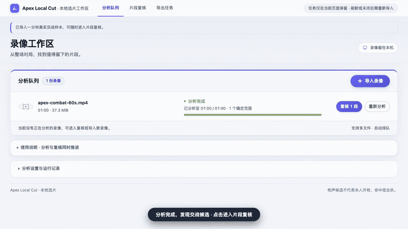

# Apex Local Cut

[English](README.md) | 简体中文

**告别手动翻找几个小时的录像：从 Apex Legends 游戏长视频中自动定位枪声候选，看着原片自由剪切，直接导出成片。**


> 💡 **提示**：自动识别定位的是**待复核的枪声候选片段**（包含本人、队友或附近的交火声音），不等于已确认的本人击杀或高光时刻。最终哪些精彩镜头值得保留，由你决定！

---

## 📺 快速上手视频演示

> *以下为核心操作演示：从载入录像、边播边选到完成片段导出。*

[](docs/assets/demo-walkthrough.mp4)

> 💡 **提示**：点击上方动态演示图可查看 [高清 MP4 完整视频](docs/assets/demo-walkthrough.mp4)（33 秒，720p 60fps）。完整视频分镜脚本与录制指引参见 [docs/video-script.md](docs/video-script.md)。

---

## 🚀 在线直接体验

**无需安装任何开发环境或客户端，使用现代浏览器即可体验：**

👉 **[打开 Apex Local Cut 在线演示](https://140.143.223.69:8443/)**

- **系统与浏览器要求**：推荐使用 **桌面端 Google Chrome** 或 **Microsoft Edge**。
- **隐私与安全**：网页与模型仅从网络加载一次，**所有视频解码、AI 音频分析和剪切导出均在你的电脑本地完成，录像绝不上传到任何服务器**。
- **快速试用**：进入页面后可点击「试用 1 分钟真实交战」，或直接点击「导入录像」选择自己的本地 Apex 录像文件。

---

## ✨ 为什么使用它？

- ⚡ **边分析边选片，无需死等**  
  几个小时的长视频不用等整片扫描完毕。导入后后台自动分析，枪声候选实时浮现；你可以立即点进片段观看原片，甚至能随时跳转到尚未分析的任意区域。
- 🎯 **双时间轴联动，看着原片调切点**  
  - **上方原片时间轴**：展示真实抽样画面预览、播放头与裁边手柄，支持拖动调整起止时间与键盘 0.1 秒精调。
  - **下方音频预测轴**：展示全局波形与枪声密度，哪有交火一目了然。
  - **一键试听**：按 `Shift + Space` 即可仅试听当前选片区间，到期自动暂停，确认无误再导出。
- 🔒 **100% 浏览器本地运算，零流量零泄露**  
  利用现代浏览器 WebCodecs 与本地 WebAssembly 模型推理，不用把动辄几十 GB 的游戏原盘上传到云端，保护隐私且不耗费宽带。
- 📁 **直接保存到指定本地文件夹**  
  支持逐片段直接导出为 **MP4**（H.264 + AAC）或 **WebM**。点击导出并选择输出文件夹后，生成成片直接写入硬盘，无需繁琐地逐个点击下载。
- 🔄 **支持多文件排队与批量操作**  
  支持一次拖入多场录像顺序排队分析；支持撤销/重做（`Ctrl/Cmd + Z`）、排除多余片段、以及根据需要添加自定义时间段。

---

## 🛠️ 三步搞定剪辑

| 步骤 | 界面操作 | 结果与说明 |
| :--- | :--- | :--- |
| **1. 导入录像** | 拖拽文件到页面或点击「导入录像」 | 支持 `.mp4`、`.mkv`、`.mov`、`.webm` 等常见格式；多文件自动排队。 |
| **2. 复核与微调** | 点击候选卡片跳转，播放原片预览前後画面 | 拖动时间轴两端手柄调整起止范围；不想导出的片段点击「排除」或取消勾选。 |
| **3. 提交导出** | 选择格式（MP4/WebM），点击「提交选片导出」 | 首次选择电脑本地保存文件夹；成片自动切段保存，期间可继续调整下一批。 |

---

## ⌨️ 常用快捷键

在复核页面任意位置均可直接使用快捷键：

| 快捷键 | 功能说明 |
| :--- | :--- |
| <kbd>Space</kbd> | 播放 / 暂停当前录像 |
| <kbd>Shift</kbd> + <kbd>Space</kbd> | **试听选片**（仅播放当前选片片段，播放至终点自动暂停） |
| <kbd>[</kbd> / <kbd>]</kbd> | 快速跳转至上一个 / 下一个候选片段 |
| <kbd>←</kbd> / <kbd>→</kbd> | 微调时间轴切点（每次 0.1 秒；按住 <kbd>Shift</kbd> 为 1 秒） |
| <kbd>Del</kbd> / <kbd>Backspace</kbd> | 排除当前选中的候选片段 |
| <kbd>Ctrl/Cmd</kbd> + <kbd>Z</kbd> | 撤销上一步操作 |
| <kbd>Ctrl/Cmd</kbd> + <kbd>Shift</kbd> + <kbd>Z</kbd> | 重做上一步操作 |
| <kbd>M</kbd> | 静音 / 恢复声音 |

---

## ⚠️ 使用须知与常见问题

### 常见疑问

- **Q: 几十 GB 的长录像会撑爆浏览器内存吗？**  
  不会。系统采用流式分块解封装与按需解码技术，不会将整个大文件一口气读入内存，低配电脑也能流畅处理长录像。
- **Q: 为什么有些激烈交火没有被自动标出？**  
  声音模型目前主要针对枪声频段特征进行筛选。如果交火距离过远、声音被极大的背景音乐或人声语音掩盖，预测分数可能会低于默认阈值。你可以随时展开「筛选与选片规则」调低阈值重新计算，或点击「添加手动范围」自行圈选。
- **Q: 刷新页面后，我刚才圈选的片段还在吗？**  
  **不在。** 为最大程度保护本地存储安全性与纯粹性，复核状态与波形目前仅存在于当前浏览器的内存中。**在刷新或关闭网页前，请务必先提交导出并确认成片已写入磁盘。**
- **Q: 为什么提示需要选择输出目录？**  
  为了避免剪出十几个精彩片段后需要手动点十几次“保存下载”，系统使用 Chrome 原生目录授权功能，直接将视频一个个存入你指定的文件夹。

### 当前限制

1. **环境限制**：依赖现代 WebCodecs、WebAssembly 与本地文件系统 API，目前**仅推荐桌面版 Google Chrome 与 Microsoft Edge**（不支持手机端浏览器及部分旧版浏览器）。
2. **导出特性**：导出的 MP4/WebM 视频会按原片分辨率与帧率进行二次编码，非无损封装切片。
3. **声音轨**：自动优先分析原片默认音频轨，导出成片保留原片默认声音。

---

## 💻 开发者与本地运行

如果你希望自行从源码启动本地静态服务，或参与模型与时间轴优化开发：

### 快速本地启动

```bash
git clone https://github.com/jackliu1111/apex-fps-mvp.git
cd apex-fps-mvp

# 启动本地静态服务（日常运行无需 Python 推理或 Node 依赖）
python3 model_web_ui/browser.prototype/serve.py \
  --assets /path/to/assets
```

打开 `http://127.0.0.1:8792` 即可访问。更多技术实现与架构说明请参阅下表：

| 专题模块 | 入口链接 | 说明 |
| :--- | :--- | :--- |
| **浏览器工作区指南** | [browser.prototype/README.md](model_web_ui/browser.prototype/README.md) | 深入操作流程、开发阶段资产转换与模型重建说明 |
| **视频分镜与录制指南** | [docs/video-script.md](docs/video-script.md) | 50 秒产品演示视频拍摄、字幕、动作与录制规范 |
| **概念术语与边界** | [CONTEXT.md](CONTEXT.md) | 候选、人工决定、请求范围与导出批次的规范定义 |
| **双时间轴与交互设计** | [docs/design/DESIGN.md](docs/design/DESIGN.md) | Descript Studio Pro 战术设计语言与时间轴架构 |
| **目录直接导出 ADR** | [ADR 0006](docs/adr/0006-directory-only-export.md) | 浏览器原生目录直接写入与取消保存机制 |
| **选片与排除解耦 ADR** | [ADR 0007](docs/adr/0007-decouple-clip-selection-from-exclusion.md) | 勾选状态与人工排除解耦的设计考量 |
| **公网与本地验收记录** | [docs/public-demo-validation.md](docs/public-demo-validation.md) | 生产环境与开发机自动化回归验收报告 |

---

*Apex Local Cut · 本地选片工作区*
