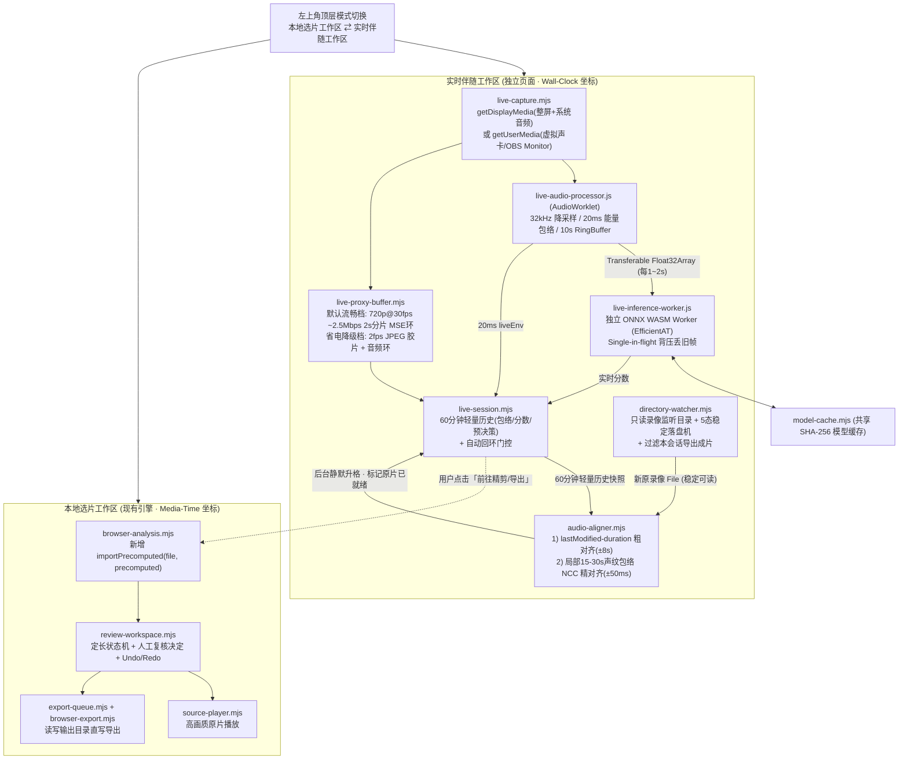
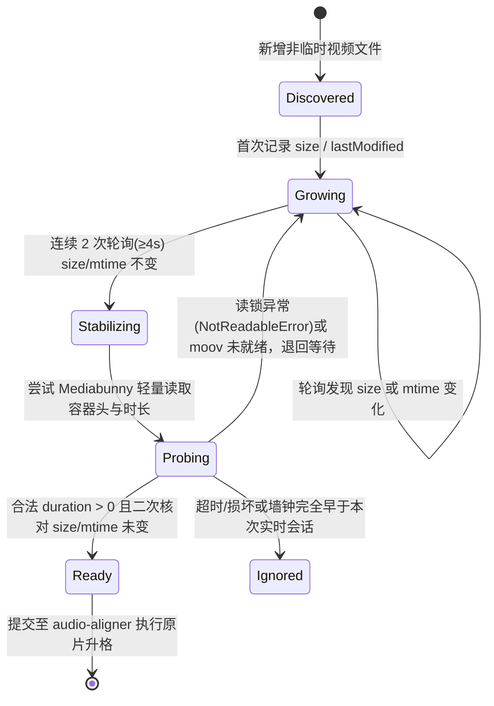

# 实时伴随分析与原片升格设计方案（路线 A）

> 关联决策：[ADR 0008](../adr/0008-live-proxy-and-directory-conform.md)｜领域术语：[CONTEXT.md](../../CONTEXT.md)  
> 适用范围：`model_web_ui/browser.prototype/` 纯静态离线浏览器架构（Windows 桌面 Chrome/Edge 优先）

> [!WARNING]
> 按 [ADR 0009](../adr/0009-recording-library-auto-intake.md)（已接受），代理画面、近期回看、局内手动打点与独立工作区相关内容（§2、§3.2）不再适用；目录监听、对齐与升格（§3.3–§3.5）继续作为参考。

---

## 1. 设计目标与核心不变量

本方案旨在为 Apex Local Cut 新增一套**与现有离线选片页面完全独立**的「实时伴随模式」，在外部录屏软件（NVIDIA ShadowPlay / OBS / AMD ReLive / Steam 后台录制等）正常硬件录屏的同时，纯浏览器离线完成：

1. **实时音画监控与增长时间轴**：默认提供最近 2 分钟（可配 1–5 分钟）的流畅代理视频缓冲（`720p @ 30fps`），同步滚动绘制实时音频波形与 EfficientAT 枪声预测脉冲。
2. **目录自动发现与原片升格**：只读监听用户的录屏目录，在新原录像落盘稳定后自动完成两阶段声纹精对齐，将实时识别结果与轻量人工预决策免重扫映射至本地高画质原录像。
3. **零后端、零侵入现有离线引擎**：继续保持纯静态部署与本地运算；不破坏 [review-workspace.mjs](../../model_web_ui/browser.prototype/review-workspace.mjs) 的定长文件不变量，不放宽外部网络 CSP。

### 核心不变量
- **代理禁止导出**：实时伴随代理仅用于观看、近期回看与预打标，绝不可作为导出批次输入；只有升格后的本地高画质**原录像**才可进入导出流程。
- **不抢焦点、不擅自重扫**：新原录像落盘升格静默完成，不强制打断实时画面；对齐低置信度或历史旧文件绝不在游戏后台自动触发整片离线扫描。
- **不自激、不自吸**：网页非静音回放时自动暂停实时听声；只读监听目录自动排除监听启动前旧文件与本会话已导出成片。

---

## 2. 顶层交互与双工作区架构

在 `index.html` 左上角 `.brand` 区域（`Apex Local Cut · 本地选片工作区`）将副标题升级为顶层**工作区模式切换器**：

- **本地选片工作区（默认）**：完整保留现有 `分析队列 / 片段复核 / 导出任务` 三页及读写型「输出目录」授权。
- **实时伴随工作区（新增，完全独立）**：独立的页面容器、独立的运行态生命周期与独立的只读「录像监听目录」授权。



---

## 3. 核心子系统与实现方案

### 3.1 实时采集与 AudioWorklet 管线（`live-capture.mjs` + `live-audio-processor.js`）

- **采集入口**：
  - **默认主路径（Windows Chrome/Edge 优先）**：`navigator.mediaDevices.getDisplayMedia({ video: { width: { ideal: 1280, max: 1280 }, height: { ideal: 720, max: 720 }, frameRate: { ideal: 30, max: 30 } }, audio: { echoCancellation: false, noiseSuppression: false, autoGainControl: false } })`。引导用户选择「整个屏幕」并勾选「共享系统音频」（注意：关闭浏览器自带回声消除/降噪/自动增益，防止破坏枪声高频瞬态特征）。
  - **备选纯净音轨 / macOS 兜底路径**：`navigator.mediaDevices.getUserMedia({ audio: { deviceId, echoCancellation: false, noiseSuppression: false, autoGainControl: false } })`，支持用户指定虚拟声卡（VB-Cable / BlackHole / OBS Audio Monitor）；此时页面自动切换为纯音频波形实时视图。
- **音频线程处理（`AudioWorkletNode`）**：
  - 从同源独立脚本 `live-audio-processor.js` 加载（完全满足现有 `serve.py` 的 `script-src 'self'` CSP，无需改服务端配置）。
  - 在音频渲染线程内完成单声道混音、线性/轻量低通重采样至 `32000 Hz`，并产出两类数据：
    1. **20ms 能量包络（50Hz RMS / Peak）**：既驱动前端实时滚动波形，又写入 `live-session` 的 60 分钟轻量历史 `liveEnv`（1 小时仅 `180,000` 个 float ≈ 720 KB），用于后续原片精对齐；
    2. **10s 环形音频窗（320,000 samples）**：每累计 **2 秒**（可调 1–2 秒）通过 `MessagePort` 直推给独立 `live-inference-worker.js`，**完全不依赖主线程 `setInterval` / `requestAnimationFrame`**，避免后台标签页被 Chrome 节流。
- **背压与异常心跳**：
  - **Single-in-flight 背压**：若上一次 WASM 推理尚未返回，直接覆盖待测槽位并丢弃积压窗口，防止团战 CPU 满载时内存飙升；
  - **静默断连监测**：监听 `MediaStreamTrack.onended` / `onmute`，并对连续超过 10 秒全 0 样本给出显著断流提示与一键重连。

### 3.2 限时流畅代理缓冲（`live-proxy-buffer.mjs`）

- **V1 默认流畅档（MSE 环形代理视频）**：
  - 采用硬件优先的 `MediaRecorder`（`video/webm;codecs=vp8,opus` 或 H.264 fMP4，按 `isTypeSupported` 自动优选）或 WebCodecs 切片器：
    - 目标规格：`720p @ 30fps`，视频码率 `~2.5 Mbps`，音频 `96 kbps`，切片/关键帧间隔 **`2 秒`**；
    - 滚动窗口：默认 **2 分钟**（用户可配置 **1–5 分钟**），2 分钟约占 ~38 MB 内存，5 分钟约占 ~95 MB，设 **150 MB 内存硬上限**；
    - 淘汰机制：MSE `SourceBuffer` 维持持续向右增长的播放时间轴，按窗口上限周期性调用 `sourceBuffer.remove(0, currentEnd - windowSeconds)` 清理过期分片，并保留 Init Segment 确保新进回看可解码。
  - **切后台保活策略**：监听 `document.visibilityState`——切回游戏进入 `hidden` 时，**仅停止前端 Canvas 波形与实时 `<video>` 叠加层渲染，保持代理切片写入与 AudioWorklet 音频推理全速运行**，保证切回网页时最近 2 分钟回看完整连贯。
  - **过载降级与省电档**：若连续观测到切片编码耗时飙升、丢帧率异常或缓冲接近 150 MB 上限，自动提示用户一键切换至「省电档（实时 `<video>` 直出 + 历史 2fps JPEG 关键帧缩略图胶片 + 2 分钟完整音频环，零视频编码开销）」。
- **媒体回环防自激门控**：
  - `<video>` 实时监控画面强制 `muted`；
  - 当用户点击播放 2 分钟代理回看视频，或跨模式播放原录像时，若播放器处于**非静音播放状态**，`live-session` 自动进入 `paused-by-playback` 门控状态，暂停实时推理与代理写入并在顶部显著提示；停止播放或静音后自动恢复（仅当采集源为 `getUserMedia` 独立纯净音轨时允许用户关闭此门控）。

### 3.3 只读目录监听与落盘稳定五态机（`directory-watcher.mjs`）

为彻底避免过早打开未写完的 MP4（缺失 `moov`）或把历史旧文件/刚导出的成片误吸进队列，采用严格的状态机与过滤器：

- **权限与隔离**：仅通过 `window.showDirectoryPicker({ id: 'apex-live-watch-dir', mode: 'read' })` 申请**只读权限**，完全独立于离线导出目录。
- **启动基线与防自吸**：
  - 启动监听时遍历一次目录记录现有文件名集合 `baselineNames`（不调用 `getFile()`，避免几百个老录像触发磁盘 I/O 风暴）；
  - 仅追踪 `baselineNames` 之外**新增的视频文件**（`.mp4/.mkv/.mov/.webm`，忽略 `.tmp/.part/.crdownload` 等临时后缀）；
  - 维护本会话导出器写入的成片集合 `exportedFilenames`（由 `export-queue` 的 `onOutput` 回调注册），显式跳过所有本应用导出的成片，即使监听目录与输出目录指向同一文件夹也绝不自循环。
- **五态稳定落盘探测**（默认 2 秒轮询，可选叠加 `FileSystemObserver` 加速发现）：



### 3.4 两阶段声纹精对齐（`audio-aligner.mjs`）

将实时墙钟坐标（`epochMs`）高精度映射到新落盘原录像的媒体时间坐标（`0 ~ duration`）：

1. **阶段 1：墙钟粗对齐（耗时 < 20ms）**
   - 估算原录像起始墙钟时间：
     $$\hat{T}_{\text{start}} = \text{file.lastModified} - \text{duration} \times 1000$$
   - 若 $[\hat{T}_{\text{start}}, \text{file.lastModified}]$ 与当前实时会话的 60 分钟轻量历史完全无交集 -> 判定为历史旧文件（`out-of-range`），不绑定实时数据。
2. **阶段 2：局部声纹包络互相关精对齐（耗时 ~50–150ms，目标精度 ±20–50ms）**
   - **选锚点**：在原录像覆盖的实时区间内，优先选取实时枪声预测分数/能量方差最高的 **15 秒片段**（若原录像时长 > 30 分钟，则分别在前半段与后半段各取一段 15 秒作为双锚点，同时校准起始偏移与长期晶振漂移）；
   - **局部跳读原片**：使用 Mediabunny `AudioBufferSink` **仅解码原录像中对应锚点的 15 秒音频**（不扫描整片），算出同频 20ms 步长能量包络 `masterEnv`（约 750 点）；
   - **归一化互相关（NCC）**：在粗对齐 `[-8s, +8s]` 搜索窗内（步长 20ms，共 800 次滑动点积，JS 执行 < 2ms）求最大相关系数 $r_{\max}$ 及对应偏移 $\Delta t^*$；
   - **三级透明降级判定**：
     - **精确对齐（`exact`）**：$r_{\max} \ge 0.65$ 且峰值显著高于次峰（信噪比达标）-> 采用 $\Delta t^*$（双锚点时线性插值），映射 `windowScores`、`waveform` 与 `liveDecisions`；
     - **粗略对齐（`coarse`）**：更换备选锚点重试一次仍 $r_{\max} < 0.65$（常见于纯混音干扰极大或音轨不匹配）-> 安全降级回 $\hat{T}_{\text{start}}$ 墙钟粗映射（依托 `candidate-ranges.mjs` 前后 5 秒 padding 兜底），UI 显著标识「粗略对齐」并提供「一键重新离线分析」；
     - **不绑定（`unmatched`）**：墙钟无交集 -> 忽略或提示作为普通离线文件处理。

### 3.5 与现有引擎的零冲突对接契约（`importPrecomputed`）

为复用现有复核页、阈值重算（`queue.recompute`）、播放器与导出管线，不破坏 [review-workspace.mjs](../../model_web_ui/browser.prototype/review-workspace.mjs) 的任何既有校验，只需在 [analysis-queue.mjs](../../model_web_ui/browser.prototype/analysis-queue.mjs) / [browser-analysis.mjs](../../model_web_ui/browser.prototype/browser-analysis.mjs) 暴露一个最小增量入口：

```js
// browser-analysis.mjs 新增接口契约（草案）
/**
 * 跳过耗时音频解码与 WASM 推理，仅运行轻量 prepare() 读取容器与音视频轨，
 * 将实时伴随模式对齐后的预测分数、波形与实时预决策无缝注入离线工作区。
 */
queue.importPrecomputed(file, {
  model: 'efficientat',
  threshold: 0.2,
  windowScores,          // Array<{ start, end, scores: [gunshot, machineGun] }>
  waveform,              // 与 createAudioPeaks(duration, trackIndex) 同结构
  alignment: {
    confidence: 'exact' | 'coarse',
    correlation: 0.84,
    offsetMs: -1120,
    driftPpm: 12,
  },
  liveDecisions,         // Array<{ kind: 'retain' | 'exclude', start, end }>
});
```

- **升格流转逻辑**：
  1. `directory-watcher` + `audio-aligner` 在后台静默完成后，在实时模式的「已就绪原片列表」及时间轴对应区间高亮标注（例如 `4K 60fps · 已精确对齐 · 3 处候选`），不打断实时监控；
  2. 用户点击「前往精剪 / 导出」时：
     - 校验 `file` 指纹与是否已导入；
     - 调用 `queue.importPrecomputed(...)` 完成 20–50ms 轻量 `prepare()` 并将 `candidates`、`waveform` 与 `liveDecisions`（通过 `workspace.addManual` / `workspace.exclude`）写入 [review-workspace.mjs](../../model_web_ui/browser.prototype/review-workspace.mjs)；
     - 将顶层模式切换为「本地选片工作区」并直接打开该文件的复核页，播放器定位于用户点击的对应媒体时间点（若此时开启了实时监听，自动触发回环门控保护）。
- **离线队列互斥**：进入实时监听运行态时，调用离线 `analysis-queue` 的暂停调度标志，阻止排队中的历史大文件在后台抢占 CPU；停止实时监听后自动恢复 `pump()`。

---

## 4. 实施路径与真机 PoC 验收标准

在改动主 UI 之前，建议按 3 个递进里程碑推进，先用真机数据把性能与精度边界验证扎实：

### 阶段 1：核心能力真机 PoC（不改 `app.js` 主流程）
1. **声纹互相关对齐离线脚本验证**：拿本地真实 Apex 录像 + 人工叠加模拟系统混音/时间偏移，验证 `audio-aligner.mjs` 在 ±8s 偏移与混音干扰下的对齐误差（目标 **≤ 50ms**）与局部解码耗时（目标 **< 200ms**）。
2. **游戏同机流畅代理压测页**：在 **Windows Chrome/Edge + Apex Legends + NVIDIA/OBS 录屏** 环境下实测 `getDisplayMedia`（`720p@30fps ~2.5Mbps` MSE 2 分钟环）+ `AudioWorklet` + EfficientAT（2s 步长）连续运行 15 分钟：
   - 核验游戏 FPS 降幅（设定红线，如 > 5% 触发参数调优或默认码率下调至 1.5–2 Mbps / 20–24fps）；
   - 核验切入游戏全屏后台后，代理视频环与音频推理是否持续无中断推进；
   - 核验内存是否稳定封顶在预算线（≤ 150 MB）以内无泄漏。
3. **目录监听稳定探测实测**：分别用 NVIDIA `Alt+F10`（即时回放）与 OBS `停止录制` 实测从按键落盘到 `Probing -> Ready` 的耗时分布，确认零半截 MP4 解析报错。

### 阶段 2：独立模式外壳与升格链路集成
1. 改造 `index.html` 左上角 `.brand-secondary` 为顶层双模式切换器，挂载完全独立的 `live-mode-shell.mjs` 容器；
2. 实现 `live-session.mjs`（60 分钟轻量历史、重叠回放独立切片、轻量打点/排除、自动回环门控）；
3. 在 `browser-analysis.mjs` 实现 `importPrecomputed`，打通「实时伴随模式 -> 静默升格 -> 一键切入本地选片复核页 -> 原画质导出」完整闭环。

### 阶段 3：边界打磨与降级保障
1. 补齐 `getUserMedia` 纯净音轨选择（Windows 虚拟声卡 / OBS Monitor / macOS 兜底）与无画面自适应 UI；
2. 补齐过载自动降级至「省电档（2fps 胶片 + 完整音频环）」与设备热插拔断流心跳重连；
3. 补齐端到端自动化验证（模拟目录新增文件、模拟导出同目录防自吸、模拟回放自激门控与粗/精对齐降级）。
