# Apex Local Cut 前端优化任务双轨拆解与规格说明书

**日期**：2026-10-30  
**状态**：轨道一已部分实施：2.1 见 ADR 0007；2.2 音量与选区试听、2.3 全局快捷键、2.4.1 波形点击寻道已完成本地实现与验收，见[视听与快捷键验收记录](ui-playback-validation-20261030.md)。滚轮缩放、列表编号及其余视觉调整继续待实施；轨道二（调度与生命周期）暂行搁置。

---

## 目录
1. [双轨拆解全景视图](#1-双轨拆解全景视图)
2. [轨道一：视觉、视听与操作反馈优化规格（立即实施）](#2-轨道一视觉视听与操作反馈优化规格立即实施)
   - [2.1 列表勾选逻辑与防呆（解除死锁）](#21-列表勾选逻辑与防呆解除死锁)
   - [2.2 播放器视听核心能力补齐（音量与选区试听）](#22-播放器视听核心能力补齐音量与选区试听)
   - [2.3 键盘快捷键全局化改造](#23-键盘快捷键全局化改造)
   - [2.4 时间轴直觉交互与联动升级](#24-时间轴直觉交互与联动升级)
   - [2.5 界面文案与视觉规范修正](#25-界面文案与视觉规范修正)
3. [轨道二：工作流调度与生命周期状态机备忘（暂行搁置）](#3-轨道二工作流调度与生命周期状态机备忘暂行搁置)
   - [3.1 分析与导出的细粒度互斥](#31-分析与导出的细粒度互斥)
   - [3.2 选片快照与不可变批次模型](#32-选片快照与不可变批次模型)
   - [3.3 导出保护（Export Protection）的两级关口](#33-导出保护export-protection的两级关口)
   - [3.4 移除与销毁（Destruction）的四级边界](#34-移除与销毁destruction的四级边界)
4. [实施路线图与测试验收要点](#4-实施路线图与测试验收要点)

---

## 1. 双轨拆解全景视图

通过 Grilling 与 Domain Modeling 访谈，我们将原本纠缠在一起的前端问题拆分为两个**高内聚、低耦合**的正交轨道：

```mermaid
flowchart TD
    subgraph Track1 ["轨道一：视觉、视听与操作反馈 (立即推进)"]
        T1_1["列表勾选解耦\n消除全选按钮死锁"]
        T1_2["播放器音频保护\nGainNode音量/静音"]
        T1_3["选区试听/循环\nShift+Space边界自动停靠"]
        T1_4["全局快捷键托管\nWindow级监听与防滚动"]
        T1_5["时间轴手势升级\n波形直接点击 + 滚轮缩放"]
        T1_6["视觉对齐与文案\n全片视野改名 + Toast提示"]
    end

    subgraph Track2 ["轨道二：工作流调度与生命周期 (搁置备忘)"]
        T2_1["细粒度调度\n未收尾区间互斥，已稳定并发"]
        T2_2["不可变批次\n选片提交快照，原选片解脱"]
        T2_3["导出保护两级锁\n批次存续锁 + 未导出变更拦截"]
        T2_4["销毁四级语义\n反选 vs 排除 vs 重置 vs 移除"]
    end

    style Track1 fill:#1a2e1a,stroke:#c6f24e,stroke-width:2px;
    style Track2 fill:#2a1a1a,stroke:#e5b65e,stroke-width:1.5px,stroke-dasharray: 5 5;
```



* **隔离原则**：轨道一修改**完全不触碰后台任务调度状态机**（`analysis-queue.mjs`、`export-queue.mjs` 状态转换保持不变），只优化渲染层与前端操作手感，风险极低、立竿见影。

---

## 2. 轨道一：视觉、视听与操作反馈优化规格（立即实施）

### 2.1 列表勾选逻辑与防呆（解除死锁）

#### 业务逻辑矛盾
* **现状**：取消 Checkbox 调用 `workspace.choose(id, false)`，该操作被记为 `exclude`（排除决定），导致 `clipsFor()` 将其从数据源过滤，渲染层将其直接从 DOM 销毁；点击「全不选」会清空全部候选，并使「全选」按钮因 `saved.clips.length === 0` 而被自身永久禁用。
* **重构规则**：
  1. **状态解耦**：
     * `clip.selected`（是否参与导出）：仅由 Checkbox 切换。未勾选时，行保留在列表中（背景透明度调低），随时可再次勾选。
     * `clip.excluded`（是否人工排除）：仅由「排除」按钮触发，打上排除标记并淡化显示，提供「恢复」按钮。
  2. **批量操作安全性**：
     * 「全选」：将当前所有非排除候选的 `selected` 批量设为 `true`；
     * 「全不选」：将当前所有候选的 `selected` 批量设为 `false`，列表项**绝不移除**；
     * 「全选」与「全不选」按钮在有任何稳定候选存在时**永远保持可用（不禁用）**。

---

### 2.2 播放器视听核心能力补齐（音量与选区试听）

#### 2.2.1 Web Audio 音量控制与静音
* **现状**：解码音频直接连入 `audioContext.destination`，以 100% 系统音量硬放，在 Apex 密集枪声场景下造成听觉伤害。
* **重构规则**：
  1. 在 `source-player.mjs` 中构建 `GainNode`：`node.connect(gainNode); gainNode.connect(audioContext.destination);`
  2. 暴露 `player.setVolume(value)` (0.0 ~ 1.0) 与 `player.toggleMute()`；
  3. 在播放控制栏右侧增加音量组件：
     * 喇叭图标按钮：点击切换静音与恢复，快捷键 `M`；
     * 水平音量调节滑块：拖动实时平滑调节 `gainNode.gain.setValueAtTime(...)`；
     * 音量设置在当前会话内记忆。

#### 2.2.2 选区试听（Play Clip Range）
* **现状**：点击播放会无限往后播，验证切点必须手动拖回起点并死盯时间码手动按暂停。
* **重构规则**：
  1. 控制栏新增「试听选片」按钮（快捷键 `Shift + Space`）；
  2. 点击后，若当前已选中某个有效选片 `clip`：
     * 播放头自动定位至 `clip.start`；
     * 开始播放；
     * 播放头到达 `clip.end` 时**自动停止播放**，并将位置停靠在终点（或复位至起点），无需用户紧急按暂停。

---

### 2.3 键盘快捷键全局化改造

#### 现状缺陷
快捷键监听绑在 `#selection-player-axis` 和 `#prediction-workspace` 两个容器上，一旦焦点移出（点击了列表、播放器、空白区域），所有快捷键全部失效，且按 Space 会触发浏览器默认的整页下滚。

#### 重构规则
1. 将 `keydown` 监听迁移到 `window`：
   ```javascript
   window.addEventListener('keydown', (event) => {
     if (event.target.closest('input, select, textarea, [contenteditable="true"]')) return;
     if (currentPage !== 'review') return;
     // 业务快捷键派发
   });
   ```
2. 统一支持的全局快捷键表：

| 快捷键 | 动作 | 预期行为 |
| :--- | :--- | :--- |
| `Space` | 播放 / 暂停 | 切换全局播放状态，阻止页面向下滚动默认事件 |
| `Shift + Space` | 试听当前选片 | 定位至起点播放，到达终点自动暂停 |
| `[` | 上一候选 | 播放头跳转至上一候选起点并激活选中 |
| `]` | 下一候选 | 播放头跳转至下一候选起点并激活选中 |
| `M` | 静音 / 恢复 | 切换播放器静音状态 |
| `Delete` / `Backspace` | 排除当前选片 | 将当前激活选片标记为排除 |
| `Ctrl+Z` / `Cmd+Z` | 撤销选片决定 | 撤销上一步裁边/排除/手动添加 |
| `Ctrl+Shift+Z` / `Cmd+Shift+Z` | 重做选片决定 | 重做下一步操作 |
| `ArrowLeft` / `ArrowRight` | 微调播放头 | 移动 0.1s（加 Shift 移动 1.0s） |

---

### 2.4 时间轴直觉交互与联动升级

#### 2.4.1 音频波形直接点击跳转
* **现状**：下层时间轴中的 `#prediction-wave` 带有 `pointer-events: none`，且容器未挂载点击寻道，用户看到声音波峰点击无效。
* **重构规则**：
  * 在 `.prediction-shared-axis` 上增加 `pointerdown` 监听；
  * 计算点击点相对于当前预测视野的百分比 `percent = (clientX - rect.left) / rect.width`；
  * 计算对应时间 `targetTime = predictionStart + percent * (predictionEnd - predictionStart)`；
  * 直接调用 `seek(targetTime)`，使得点击枪声波峰能够瞬间让播放头跳至交火点。

#### 2.4.2 滚轮缩放与平移手势
* **重构规则**：
  * 在时间轴区域监听 `wheel` 事件；
  * **普通滚轮垂直滚动 / 双指捏合**：以鼠标指针所在的时间戳为中心，平滑缩放视野；
  * **Shift + 滚轮 / 双指水平滑动**：横向平移当前视野窗口；
  * 彻底减少用户频繁去点击「放大」「缩小」「←」「→」按钮的交互成本。

#### 2.4.3 列表与时间轴标号完全对账
* **现状**：时间轴候选方块为 `1`、`2`、`3`，列表中只有时间戳无编号。
* **重构规则**：
  * 列表项首部增加醒目标签：`[1]`、`[2]`、`[3]`；
  * 保持列表行编号与时间轴方块编号严格 1:1 镜像对齐。

---

### 2.5 界面文案与视觉规范修正

1. **消除文案误导**：
   * 原片时间轴右上角的「退出选片」更名为**「全片视野」**（其真实作用是恢复时间轴为全录像跨度，非放弃选片）；
2. **清除外部链接混淆符号**：
   * 移除「提交选片导出 ↗」与「试用 1 分钟真实交战 ↗」中的外链箭头 `↗`，防止误导用户以为会离开当前系统；
3. **主行动按钮（CTA）色彩纠偏**：
   * 「提交选片导出」从危险深红色（`#b02a24`）调整为正向高对比度的肯定色（如深色主题下的高亮白底粗体或品牌高光色），与破坏性的「重置人工选片」形成明显安全区隔；
4. **轻量浮动 Toast 替换硬推挤状态栏**：
   * 频繁出现的瞬态反馈（如“没有更早的候选”、“已复制报告”）改为固定在屏幕右下角自动淡出的 Toast，避免顶部 `#status` 频繁插入造成的页面垂直累积布局偏移（CLS）。

---

## 3. 轨道二：工作流调度与生命周期状态机备忘（暂行搁置）

> [!NOTE]
> 本部分记录当前讨论沉淀的设计边界与核心共识，后续在开展第二阶段（后端与调度重构）时直接作为基线输入，本次暂不编写代码。

### 3.1 分析与导出的细粒度互斥
* **核心共识**：互斥的粒度不应是整个系统或整份文件，而应精确到**未收尾的区间（Provisional Range）**。
* **规则设定**：
  * 录像中处于当前分析滑动窗口边界内的未稳定候选（`provisional: true`）禁止导出；
  * 已完成收尾的稳定片段允许随时导出；
  * 同录像导出与后续分析的 IO 竞争调度，由后台节流层自适应协调，不再粗暴一刀切。

### 3.2 选片快照与不可变批次模型
* **核心共识**：提交导出生成的是**不可变批次快照（Frozen Snapshot）**。
* **规则设定**：
  * 点击导出后，被提交的片段参数（起止时间、音轨、分辨率）被复制并固化入批次；
  * 前端复核界面立即解脱，用户对这些片段后续进行的任何裁边或反选，均归入“下一批次”，绝不污染正在运行的既有批次。

### 3.3 导出保护（Export Protection）的两级关口
* **第一道：运行时文件句柄锁**
  * 只要录像有状态为 `awaiting-destination`、`queued` 或 `running` 的批次，该录像处于受保护状态，**禁止移除**。
* **第二道：用户成果防丢拦截**
  * 若录像存在未提交导出的人工裁边调整（`hasUnexportedChanges === true`），在用户尝试**关闭网页**或**手动移除录像**时，必须弹出弹窗二次确认。

### 3.4 移除与销毁（Destruction）的四级边界
1. **反选（Deselect）**：仅本批不导出，候选数据完好；
2. **排除（Exclude）**：人工标记为垃圾候选，软隐藏但可随时恢复；
3. **重置（Reset Decisions）**：清空人工裁边与手动片段，回退到 AI 原始预测（已提交批次不被重置）；
4. **移除录像（Remove Source）**：销毁当前会话内的分析 Worker 与解码句柄，**磁盘上已保存的物理成片文件永远保留**。

---

## 4. 实施路线图与测试验收要点

### 4.1 实施顺序（轨道一）
1. **第 1 步：修复列表 Checkbox 与全选死锁**（修改 `app.js` 的 `renderClips` 与 `workspace.choose` 接入方式）；
2. **第 2 步：增加 Web Audio GainNode 与音量控制组件**（修改 `source-player.mjs` 与 `index.html` 播放栏）；
3. **第 3 步：实现 Shift+Space 选区试听与边界自动停靠**；
4. **第 4 步：快捷键全局托管至 window**（重构 `selection-timeline.mjs` 中的 `keydown` 监听器）；
5. **第 5 步：时间轴交互升级**（支持波形点击寻道、支持滚轮缩放、列表添加序号徽章）；
6. **第 6 步：文案与视觉色彩规范修正**（「全片视野」、去 `↗`、Toast 浮层样式）。

### 4.2 验收用例
* [x] 在片段列表中取消任意 Checkbox，该行仅变暗，依然留在列表内；
* [x] 点击「全不选」，所有 Checkbox 取消勾选，列表不被清空，「全选」按钮依然可以点击并恢复全选；
* [x] 播放视频时拖动音量滑块可平滑调小/调大声音，点击静音按钮音量归零，再次点击恢复；
* [x] 选中某个片段后按 `Shift + Space`，视频从选片起点播放至终点自动暂停；
* [x] 点击页面空白处或列表后，按 `Space` 能正常控制暂停与播放，网页不发生垂直下滚；
* [x] 点击下层音频波形尖峰处，播放头瞬移至该波峰对应的时间戳；
* [ ] 时间轴候选方块为 `1` 时，列表第一项带有清晰的 `[1]` 标记。
