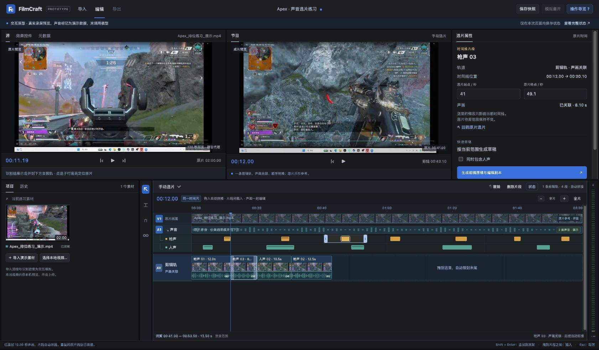

# Prototype capture

Current revision: one continuous editing lane contains linked picture and sound, with automatic append and gap closure. This supersedes the earlier V2/A2, V3/A3 multi-track creation behavior. A's dual recognition lanes remain below the original A1 reference. Bounded checks for each revision are recorded separately below; the latest screenshot is `evidence/prototype-single-track.jpg`. The current delivery branch is `codex/grill-ai-selection-decisions`; this sync includes the browser prototype and its evidence, excluding the new native implementation. Earlier observations apply only to their corresponding revisions.

## Initial A/B/C revision — local-only archive `d3f2506`

Question: Does sound-lane selection, independent range editing, drag insertion, and current-range assembly feel usable inside FilmCraft's established desktop panel layout?

Status: ready for user trial; no UI variant preference has been inferred. The already accepted decisions are reproduced in this prototype, not newly validated model or product claims.

The initial study was captured on the development machine in the local-only throwaway branch `codex/prototype-filmcraft-ai-selection`. Its commits are historical local references, not required or published GitHub branches. The cleaned source and evidence for that revision were delivered on `feature/prototype`. No implementation issue was provided; this file retains the design and verification context.

The UI is a browser shell because the FilmCraft host is native Rust and has no existing browser route. All variants live on the same local route with `?variant=A|B|C`, replacing only the recognition subsection. The user's requirement to retain the original layout takes precedence over the skill's generic suggestion of radically different whole-page layouts.

Observed through browser interactions on 2026-10-13:

- A source range was physically dragged into the timeline at 2.20 seconds, producing linked video/audio spanning source 5–17 seconds.
- Dragging the original range handles changed the pending range to 8.02–15.97 seconds while the placed clip stayed at source 5–17 seconds.
- Assembly including voice produced seven merged clips, including the edited 8.02–15.97-second range, and kept the manual sequence plus a baseline and editable copy.
- After a keyboard-focus fix, repeated arrow presses on a boundary changed 5.0 → 5.1 → 5.2 without switching variants.
- A/B/C switches preserved pending ranges. Saving an in-memory snapshot, creating a draft, and simulating reopen restored the prior sequence and edited range.
- Browser console inspection at that stage returned no captured errors or warnings.
- Two queued demo imports completed in order and left the timeline empty; progress remained explicitly labelled as simulated.
- Numeric source-range inputs were checked after the live-update fix: entering 8 and 16 immediately changed the highlighted pending range to 8–16 seconds. Assembly then used that exact range.
- The assembled sequence was played through several clip transitions; at sequence 35.49 seconds the preview corresponded to the fourth clip, source about 58.4 seconds, before pausing. This checks basic preview traversal, not frame-accurate or audio synchronization.

These are bounded interactive checks, not automated tests, real inference, actual on-disk recovery, a user usability verdict, or native FilmCraft validation. Further observed checks are appended here when completed.

Media provenance and exact original-time mapping are in `media-fixture.json`. The small preview was generated from an existing local recording; the source was not changed.

## Revision: A integrated into the original audio track — 2026-10-13

Question: Does placing the gun/voice classification rows beneath original audio A1, sharing the main ruler, zoom, and playhead, make range selection and copying into separate editing tracks easier to understand and operate?

User direction:

- Keep A's two classification rows, moved into the lower main timeline as expandable children of original audio A1. Original video V1, audio A1, and recognition overlays share the ruler, zoom, and playhead. The source monitor remains a preview; it has no separate recognition strip.
- Classification children are overlays describing the original audio, not separated gun/voice audio stems.
- Dragging a highlight body copies its current audiovisual range into a new editing track pair, starting with V2/A2 and then V3/A3. Dropping into an existing editing pair ripples only that pair. Original V1/A1 and other editing pairs stay intact.
- Pending ranges and copied clips remain independent. Q14 choice B still means assembly uses adjusted ranges where present and defaults elsewhere; it is unrelated to the retired UI variant B.
- Retire the B/C exploratory layouts and the variant switcher. Continue the integrated version on the same `?variant=A` route. The old variations remain recoverable from the development machine's local-only `d3f2506`; this GitHub source includes their historical screenshots and observations, not their retired implementations.

Status: the checks below have been completed through actual browser interaction and DOM inspection. This remains a browser-only demonstration using fixture data and memory state, with no native FilmCraft feature change, new model output, or disk project persistence. The checks establish the specified interactions, not a user usability verdict or full product acceptance.

Observed for this revision on 2026-10-13 (times shown to two decimal places where applicable):

- Physically dragging `gun01`, source 5–17 seconds, created linked clips on a new V2/A2 pair at timeline 19.92 seconds.
- Physically dragging `voice02`, source 22–32.5 seconds, created another linked pair on V3/A3 at timeline 49.92 seconds.
- Dropping `voice02` into V2/A2 at timeline 25.08 seconds split the existing gun clip into source 5–10.17 and 10.17–17 seconds. The second gun portion moved to timeline 35.58 seconds, while the V3/A3 clip remained at 49.92 seconds. This demonstrates insertion confined to the target editing pair.
- Undo restored both editing pairs to their pre-insertion state.
- At a shared zoom interval of 19–35.5 seconds, DOM inspection found matching left alignment and 488 px widths across the track and classification rows. A1's classification children successfully collapsed and expanded.
- Keyboard adjustment changed the pending voice start from 22 to 22.1 seconds; the already-created clip retained source 22–32.5 seconds, demonstrating independent pending and placed ranges.
- Browser console inspection returned no captured warnings or errors during these checks.

Final interaction fix and follow-up check:

- Recognition-row repainting had allowed the initiating `pointerdown` to bubble to the parent timeline and shift the position. This event propagation was corrected.
- After refreshing the page, a physical drag of `gun01` created a new V2/A2 pair at timeline 20.03 seconds with source 5–17 seconds.
- Dragging the pending range's right handle changed 5–17 to 5–19.55 seconds. The source preview and shared playhead both reached 19.55 seconds; the existing V2/A2 clip retained source 5–17 seconds.
- Clicking `gun01` again set both the source preview and shared playhead to 10.00 seconds.
- Final layout screenshot: [integrated timeline prototype](evidence/prototype-timeline.jpg). The screenshot records the browser demonstration's visible state, not native FilmCraft validation.

Cancellation, repeated-use hint updates, current-range assembly, and in-memory snapshot restoration were not rechecked in this revision. Prior-revision observations do not establish those behaviors for the revised layout. These checks also do not establish frame-accurate preview, audio synchronization, actual inference, on-disk recovery, or native FilmCraft behavior.

Local capture completed as `423afc2` on `codex/prototype-filmcraft-ai-selection`; the earlier capture is retained locally. That revision was delivered on `feature/prototype`, including its timeline screenshot. Canonical product decisions are in `docs/design/ai-recognition-workspace.md`; the former duplicate DESIGN-SNAPSHOT.md has been removed during repository cleanup.

Final preview synchronization check: after the last preview fix, a physical drag created V2/A2 at timeline 0–12 seconds from source 5–17. Selecting gun 01 positioned the source preview and shared ruler at 10.00 seconds while the program preview mapped the clip to source 15.00 seconds. The final screenshot shows this state. Browser console inspection returned no captured warnings or errors.

## Revision: one linked audiovisual editing lane — 2026-10-13

The user clarified that created picture and associated sound should be in the same editing dimension and automatically concatenate. Each sequence now has one editing lane. Each block displays picture and a waveform together; dragging into empty space or pressing Shift+Enter appends at the end. Dropping near an existing clip snaps to its nearest boundary and inserts a whole clip, shifting subsequent content. Trimming and deletion close gaps. Source V1/A1 and recognition events remain reference material.

Observed through actual browser interaction on `?variant=A&revision=single-track`:

- Dragged gun 01 (source 5–17) into empty editing space well after zero: it became sequence 0–12, without a leading gap.
- Dragged voice 02 (source 22–32.5) into empty editing space: it appended at 12–22.5 on the same lane.
- Dragged gun 03 (source 41–53.5) between those clips: it occupied 12–24.5 and voice 02 shifted to 24.5–35. No extra track or split source fragment was created.
- Changed gun 03's end with a numeric edit followed by a keyboard increment to 49.1: the placed clip shortened to 8.1 seconds, voice 02 moved to 20.1–30.6, and the pending source range remained 41–53.5.
- Focused the first placed clip, activated it with Enter, and pressed Delete: that clip was removed, with the remaining clips closing to 0–8.1 and 8.1–18.6. One Undo restored all three clips and their positions.
- With the playhead at zero, Shift+Enter on gun 02 appended source 22.5–35 at sequence 30.6–43.1. Duplicate source content was retained and reported, without overlapping output layers.
- Played the program from about 11.2 seconds across the intervening clip transitions. At about sequence 32.36, the program displayed source about 24.08 from the final clip. This establishes basic traversal, not frame-accurate playback or audio synchronization.
- The browser showed one editing row with four linked blocks. No captured warning or error logs were returned during the check.

Additional checks: JavaScript syntax and `git diff --check` passed. Small in-memory state assertions covered append, boundary snapping, single-track continuity, trim/delete/undo, independent pending ranges, read-only baselines, editable copies, and snapshot restoration. No new test suite was added.

This remains a fixture-based browser prototype. Real inference, real audio, persistent project save/reopen, native FilmCraft editing, and actual export were not validated. Queue/cancellation, draft creation and snapshot recovery were not repeated through the browser in this revision; state-level checks are not a substitute for those UI paths.

## Repository sync — 2026-10-14

The single-lane browser prototype, screenshot, and design discussion were synchronized to `codex/grill-ai-selection-decisions`. JavaScript syntax and diff whitespace checks passed. In-memory checks passed for append, boundary insertion, linked single-lane continuity, trim/delete gap closure, undo, independent pending ranges, repeated use, current-range draft creation, baseline/copy isolation, and snapshot restoration. Browser interactions were not repeated during this repository sync; the observations above remain bounded to their original capture. The new native implementation and native validation results are excluded from this branch.
